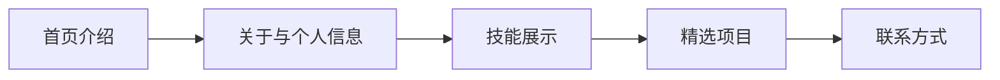

# RoourChen Website · 个人展示主页

**把个人介绍、技能、项目与联系方式放在同一个页面，浏览者可以沿着导航快速了解你。**

一个使用 HTML、CSS 和原生 JavaScript 编写的单页网站。页面布局、样式和交互都放在 [index.html](./index.html) 中，无需安装前端框架或执行构建命令。

> 当前页面保留示例人物资料、项目说明和占位链接。用于自己的主页前，需要替换为真实内容。页面中的留言输入框尚未接入发送或保存功能。

## 📊 浏览流程



顶部导航可以跳转到对应区块，页面右下角提供返回顶部按钮。

## ✨ 已实现的页面能力

| 能力 | 实际内容 |
| --- | --- |
| 🏠 首屏介绍 | 姓名、职业说明、作品与联系入口，以及个人信息、技能和项目数量展示卡片 |
| 👤 关于页面区块 | 个人介绍、所在地、邮箱、学历与合作状态 |
| 🧩 技能与项目展示 | 技能标签、四张示例项目卡片和项目详情链接位置 |
| 📱 响应式布局 | 根据屏幕宽度调整卡片列数，小屏显示折叠菜单 |
| 🧭 滚动导航 | 平滑滚动、当前区块高亮、顶部导航背景变化与返回顶部 |
| ✨ 入场动画 | 使用 IntersectionObserver，在内容进入视口时显示动画 |

项目卡片里出现的电商、实时监控、云同步和小程序等描述属于展示文案，本仓库没有包含这些项目的应用代码。

## 🧱 技术组成

| 部分 | 实现方式 |
| --- | --- |
| 页面结构 | HTML5，入口为 `index.html` |
| 样式 | 内联 CSS、CSS 变量、Grid、Flexbox 与媒体查询 |
| 交互 | 原生 JavaScript、滚动监听和 IntersectionObserver |
| 字体 | Google Fonts 提供 Inter、Noto Serif SC 与 Source Serif 4，并设置系统字体回退 |
| 图形 | 内联 SVG 与文本图标 |

页面中展示的 Vue、React、TypeScript 等技能标签是人物资料，本网站自身没有使用这些框架。外部字体加载需要网络，加载失败时会使用回退字体。

## 🚀 快速开始

### 方式一 · 直接打开

在有仓库访问权限的账号下下载或克隆代码，用现代浏览器打开 `index.html` 即可查看页面。浏览时需要启用 JavaScript，以显示入场动画内容并使用菜单等交互。

### 方式二 · 本地 HTTP 预览

如果已安装 Git 和 Python 3，可以在终端运行下面的命令。私有仓库需要先配置有权限的 GitHub 登录方式。

```bash
git clone https://github.com/RoourChen/RoourChen-website.git
cd RoourChen-website
python3 -m http.server 8000 --bind 127.0.0.1
```

打开 [本地预览页面](http://127.0.0.1:8000)。终端按 `Ctrl+C` 停止服务。若 8000 端口被占用，改用其他端口，并同步修改浏览器地址。

Python 仅用于这种预览方式，网站本身运行时不依赖 Python。

### 预览时可以检查什么

| 操作 | 预期表现 |
| --- | --- |
| 点击顶部“关于”“技能”“项目” | 页面滚动到相应区块 |
| 缩小窗口到手机宽度 | 导航切换为菜单按钮，内容按单列排列 |
| 滚动页面 | 当前导航项高亮，进入视口的内容逐渐显示 |
| 滚动到页面较下方 | 右下角出现返回顶部按钮 |
| 点击“了解更多”或留言发送按钮 | 当前仍有占位链接和未接入的功能，详见下方限制 |

## ✏️ 改成自己的主页

使用文本编辑器打开 `index.html`，按下表定位内容。姓名和联系方式会在多处出现，替换后需要全文搜索检查。

| 要修改的内容 | 文件中的位置或搜索词 |
| --- | --- |
| 浏览器标签标题与页面简介 | `<title>`、`<meta name="description">` |
| 姓名、职业、地区和经历 | `#home`、`#about`，以及导航和页脚中的人物信息 |
| 技能 | `#skills` 与首屏技能卡片 |
| 项目名称、说明和链接 | `#projects` 内的 `.project-card` |
| 邮箱与社交入口 | `#contact`、`mailto:` 与联系卡片中的 `href` |
| 颜色和字体 | `<style>` 开头的 `:root` 变量 |
| 页脚年份与署名 | `<footer>` |

尤其需要核对以下示例内容。

- 页面中的工作年限、项目数量和学历，应改成可以确认的真实信息。
- 示例邮箱 `chenjiayi@example.com`、示例电话与社交账号，需要替换后才能作为联系入口。
- 项目“了解更多”链接目前为 `href="#"`，GitHub 联系入口目前指向 GitHub 首页，需要填写实际目标地址。

## 📌 当前限制

| 项目 | 当前状态 |
| --- | --- |
| 留言发送 | 有输入框和按钮，尚无发送事件、接口或存储 |
| 联系入口 | 邮箱使用 `mailto:` 链接；微信和电话卡片尚未配置有效跳转 |
| 项目详情 | 只有展示卡片，没有详情页或项目应用代码 |
| 后台与数据 | 没有登录系统、内容管理后台或数据库 |
| 自动构建与部署 | 仓库未提供构建脚本或部署工作流 |

若准备提供真实留言功能，需要另外开发提交处理及存储，再更新页面中的回复承诺。

## ❓ 常见问题

**打开后字体与预期不同？**

页面通过 Google Fonts 加载字体。网络无法访问该服务时会回退到系统字体，字形可能变化。需要完全离线使用指定字体时，要另外准备字体文件并调整样式。

**为什么有些内容一直没有出现？**

带 `.reveal` 的区块初始透明，由 JavaScript 的 IntersectionObserver 显示。检查浏览器是否禁用了脚本，再查看开发者工具是否有脚本错误。

**留言为什么没有发送成功？**

当前只提供输入框和按钮的样式，没有提交处理。页面不会保存或发送输入的文字。

**下载下来能直接当成自己的简历网站吗？**

可以先在本地预览，但公开使用前需要逐项核对和替换人物经历、项目介绍与联系地址。页面里的示例工作年限和项目数量不能直接当作自己的资料。

## 📁 目录结构

```text
RoourChen-website/
├── README.md      # 项目介绍、预览与修改指南
├── index.html     # 页面结构、全部样式与交互脚本
└── .gitignore     # 忽略本地 .DS_Store 文件
```

## 🧪 修改后的检查

仓库当前没有自动化测试配置。替换内容后，可在浏览器中进行以下手动检查。

1. 在电脑和手机宽度下查看布局，确认文字与卡片没有超出屏幕。
2. 点击导航、移动端菜单与返回顶部，确认能到达相应位置。
3. 逐个打开作品和联系链接，确认不再指向示例地址。
4. 检查浏览器标题、首屏和页脚是否都使用了自己的资料。

## 📄 项目文件与许可

全部页面代码见 [index.html](./index.html)。本项目采用 [MIT License](LICENSE)。
